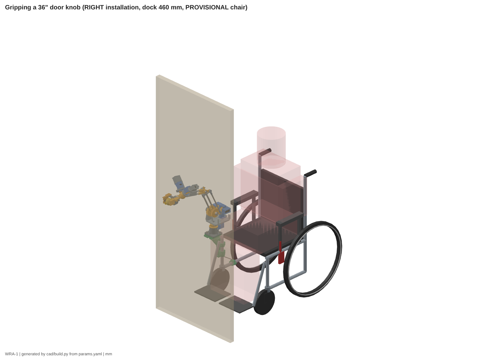

# WRA-1 — Engineering report

**3D-printable AI wheelchair robotic arm with an ABENICS wrist and a door-knob claw**

> **Status: research prototype.** WRA-1 has been designed and checked in CAD and in simulation. It has **not** been built or tested.
>
> It is **not safe for human-facing use** until the staged structural, electrical and operational tests in `docs/09_safety.md` (T0–T5) have passed and been logged in `docs/test_log.md`.
>
> All chair dimensions in the CAD are **provisional** until you measure your chair (`docs/12_measurement_worksheet.md`).

The numbers below come from the generated reports:
- `output/reports/` — parts, BOM, verification, sweeps, chair checks.
- `calcs/output/results.json` → `docs/05_calculations.md`.

Every number can be regenerated from `cad/wra/params.yaml` with the commands in `README.md`.

---

## 1. Executive summary

**What it is.** WRA-1 is a 6-DoF assistive arm for a power wheelchair; the reference chair is the Drive Silver Sport 2. It docks on the **left or right** front frame post using exactly the same parts. Its main job is **opening doors**: grip a knob, turn it, crack the door open, and let go. It also fetches and moves light objects.

**Hardware.**
- 8 × Waveshare ST3215 serial-bus servos.
- An ESP32 safety supervisor that is the only master of the servo bus.
- An NVIDIA Jetson Orin Nano 8GB running ROS 2 Humble.
- A ReSpeaker USB mic for offline voice commands.
- A hard-wired E-stop that cuts servo power without any software.

**Every printed part fits the Bambu Lab P1S bed** (256 mm). There are no camera mounts or camera-specific structures. Future vision only needs to publish a knob pose on `/wra/knob_pose`.

| key figure | value | source |
|---|---|---|
| degrees of freedom | J1 yaw · J2 shoulder · J3 forearm (parallelogram, absolute) · ABENICS 3-DoF wrist (pitch, yaw, roll) · claw | docs/02 |
| servos | 8 (J1, J2, J3, 2 × q, 2 × Θ, claw) + 1 spare | BOM |
| max horizontal reach (TCP) | **593 mm** from the J1 axis | docs/05 §4 |
| payload | 0.30 kg rated at full reach (0.36 kg computed limit); 0.5 kg close-in target | docs/05 §4 |
| arm mass on the dock / beyond the shoulder | 3.16 kg / 1.74 kg | docs/05 §1 |
| wrist | tilt ±30° (21° toward a module), roll ±90°, 180°/s | docs/06 §3 |
| knob turning | roll torque 2.2 N·m continuous, **2.65 N·m** in knob mode (≤ 10 s) | docs/05 §5, §10 |
| claw | 0–65 mm parallel opening, 35 N per jaw continuous / 70 N knob mode, 100° V-pads with lips | docs/05 §11 |
| TCP accuracy (estimate) | ≈ 5.7 mm RSS, to be measured in test T2.4 | docs/05 §9 |
| printing | 49 part files, 72 prints, ≈ 2.6 kg filament, ≈ 105 h | docs/13 |
| purchased parts | 75 BOM lines, ≈ $577 (all 9 servos included; Jetson and mic excluded) | output/reports/BOM.md |
| power | ≈ 43 W typical, 177 W worst case; ≈ 1.4 h on a 72 Wh pack | docs/05 §8 |

**What was checked (virtually):**
- **Solid models — verification ALL PASS.** All 57 part files are valid single solids, sit on the bed and fit it, with watertight STLs whose STL/STEP volumes match the solid model; 17/17 interface checks pass (belt lengths, gear centre distances, claw travel, kinematics round trip). See `output/reports/verification.md`. That run also caught and fixed a 3-body elbow block, two caps whose screw holes were as wide as their walls, and a fork screw hole tangent to a face.
- **Interference sweeps.** The ABENICS wrist and claw were swept through 73 poses at the hard limits with every solid and the toothed gears: no interferences, and the largest tooth overlap is 0.20 mm³ (sweep-step slivers). The full arm was swept through 16 poses, and LEFT and RIGHT installations were checked on the reference chair (park, plus gripping a 36" knob).
- **Calculations.** Mass, springs, joint torques, payload against reach, structure, gear teeth, belts, power, accuracy and the knob reach window.
- **Software.** The driver passes 10 automated tests against a simulated ESP32, including the full door-knob sequence, a stiff-latch abort, the Θ torque cap and the user keep-out zone. The ESP32 firmware was **compiled and linked for the real chip** with the same core and compiler PlatformIO uses.

**What is not done.**
- Nothing has been printed, wired, powered or tested.
- The chair geometry is provisional.
- The firmware has not run on a board.
- Several material and friction values are estimates; they are tagged [E].

Sections 12 and 13 list exactly what has to happen before anyone sits in the chair with the arm powered.

## 2. Research and sources

Full notes and 14 numbered sources are in `docs/01_research_findings.md`; the architecture comparison is in `docs/02_architecture_trade_study.md`.

**Door hardware sets the task.**
- **ADA 2010 §404.2.7** puts door hardware 34–48 in (864–1219 mm) above the floor.
- **§309.4** limits operating force to 5 lbf (22.2 N), with no tight grasping or wrist twisting. That is why public buildings use levers.
- **BHMA A156.2** caps lever latch torque at 28 lbf·in (3.2 N·m) [1].
- Knobs are still common in homes, which is where a personal arm is needed.

The reliable robot strategy is to **unlatch first, then follow the door's arc compliantly**, as in equilibrium-point control on the Cody robot [2]. WRA-1 does the same at small scale.

**Prior art.**
- Kinova JACO and iARM are the established wheelchair-mounted arms [3].
- JACO cut the assistance time users needed [4].
- Long-term users kept using it for daily tasks, including doors [5].
- A literature review rates door opening among the most valued and hardest tasks [6].

**ABENICS** (Abe, Tadakuma & Tadakuma, *IEEE T-RO* 2021 [7], overviews [8][9]) is a cross-spherical gear driven by two monopole gears. That gives 3 DoF from one compact ball joint. F. Thomas derived closed-form kinematics and a three-actuator variant [10]. Hobby replications exist only as unloaded demonstration models [11].

**Actuator data.** The ST3215 numbers are verified from Waveshare [12]: 30 kg·cm stall at 12 V, 0.222 s/60°, 12-bit magnetic encoder, 6–12.6 V, 89 g. The register map was cross-checked [13], and the Bus Servo Adapter (A) wiring comes from the Waveshare wiki [14].

**Architectures compared** (docs/02, weighted scores out of 5):

| | A — WRA-1A (chosen) | B — WRA-1B (fallback) | C — direct-drive serial 6-DoF | D — SCARA + lift column |
|---|---|---|---|---|
| wrist | ABENICS 3-DoF | pitch + roll | 3 servos in series | roll only |
| score | **3.85** | 3.70 | 3.25 | 2.75 |
| verdict | only option with independent wrist yaw and a centred roll strong enough for knobs | same arm and claw, switch `wrist_type: pitch_roll` if ABENICS fails testing | too weak at reach (elbow servo carries the wrist servos) | knob height and chair-side bulk |

## 3. Mechanical architecture and joint specifications

**The core idea:**
- Keep the servos near the base.
- Make the moving links aluminium tubes joined by printed nodes.
- Cancel gravity with springs, so the servos carry only payload and door forces.

**Base and positioning.**
- **J1:** the drive module walks round a fixed 54T pulley.
- **J2 and J3:** belt-driven from a dual drive module on the turntable.
- **J3 is absolute** through a parallelogram, so its servo never rides on the arm.
- **Zero-free-length springs** (extension spring + Dyneema cord over an idler) cancel ≈ 90 % of the gravity torque in every pose. The worst J2 torque drops from 3.59 to 0.37 N·m (docs/05 §3).
- **Servo output shafts carry torque only.** Every pulley turns on its own bearings and pin, the ABENICS carriers run in 6808/6805 bearings, and the claw racks run on an MGN9 rail.

**Wrist (WRA-1A) and claw.**
- **Wrist:** two monopole modules on axes 45° either side of vertical drive a 34-tooth (m1.5) cross-spherical gear. A fixed centre ball takes all force, so the teeth only transmit torque.
- **Claw:** a single pinion drives two racks, so the parallel jaws stay centred on the roll axis. The 100° V-pads centre round knobs, and 6 mm lips hook behind them.

| joint | drive | ratio | range (soft) | torque continuous / peak | speed |
|---|---|---|---|---|---|
| J1 yaw | drive module round a fixed 54T, HTD-3M-15 belt | 1.5 | ±105° | 1.10 / 2.21 N·m | 180°/s (software 30°/s) |
| J2 shoulder | dual drive module → 86T; springs 2 × 1.12 N/mm | 2.39 | −30…100° | 1.76 / 3.51 N·m + springs | 113°/s |
| J3 forearm (absolute) | → 72T + parallelogram; springs 2 × 1.55 N/mm | 2.0 | −95…60°, θ2−θ3 ∈ [42°, 140°] | 1.47 / 2.94 N·m + springs | 135°/s |
| wrist pitch / yaw | ABENICS, Θ-servos via 20T/15T m1.5 | sphere = 1.5 × Θ-servo torque per module | tilt 30° (21° toward a module); hard 33° / 24° | 1.10 N·m per module | 180°/s |
| wrist roll | ABENICS, both modules | — | ±90° | 2.2 N·m; **2.65 N·m knob mode** | 180°/s |
| claw | 14T m1.5 pinion, 2 racks, MGN9 rail | r = 10.5 mm | 0–65 mm | 35 / 70 N per jaw | 49 mm/s per jaw |

| link | length |
|---|---|
| shoulder height above the dock | 185 mm |
| upper arm L2 | 250 mm |
| forearm L3 (to the sphere centre) | 230 mm |
| sphere centre → tool flange | 56 mm |
| flange → TCP (pad centre) | 88.5 mm |

**Wrist size and mass.**
- From the CAD, the ABENICS wrist with its 4 servos is **245 mm wide × 149 mm tall × 252 mm long** along the forearm axis (housing to tool flange). The claw adds 116 mm of length.
- The forearm with the wrist (housing, both modules, 4 servos) weighs 909 g, and the claw with its servo 293 g.

**Wrist checks done in this release.**
- **Θ-pair phasing fixed.** The 20T/15T Θ pair is now meshed in phase. With an odd 15T gear, the old "gap faces the monopole" rule was wrong, and the sweep showed 36 mm³ of tooth overlap.
- **Tip relief added.** The 15T gear on each monopole now has a revolved tip relief, 0.4 mm outside the CS tip sphere. Without it, its tip corner clipped the CS teeth by up to 0.76 mm³ at the wrist limits.
- **Claw servo clearance.** The claw servo moved 1 mm forward to clear the tool adapter.

Details: `docs/06_abenics_wrist.md`.

## 4. Left/right interchangeability

**The arm is one design and is never mirrored.** Every link, joint, the wrist and the claw are identical on both sides.

**There are no side-specific printed parts.** The post bracket, receiver, clamps, e-box and pendant are the same parts, only placed differently. What changes per side:

| item | how it changes |
|---|---|
| post bracket | rotated 180° about the post, so the shelf stays outboard |
| e-box | turned upside-down on the other rear cane |
| torque strut | moves to the other lower rail |
| software | one parameter, `side:=left|right`, which sets the chair → base_link transform and the park direction |

**Mirrored kinematics and limits.** A task taught on one side is mirrored by `mirror_q`: J1 → −J1 and wrist (p, y, r) → (p, −y, −r). The joint limits are symmetric about the arm's own plane, and the calibration lives in the arm.

**Retention is positive, not friction alone.**
- 2 dowels and 2 thumb screws at the dock.
- A torque strut against rotation on the post.
- A stop collar under the lower clamp.
- A steel tether.

**Switching sides takes 10 steps, about 30 minutes, with no reprinting** (`docs/03_left_right_interchangeability.md` §2).

**CAD installation check at the 460 mm dock height** (`output/reports/chair_check.json`):

| | RIGHT park | RIGHT 36" knob | LEFT park | LEFT 36" knob |
|---|---|---|---|---|
| interferences with chair / user envelope | none | none | none | none |
| closest: footrest hanger (post bracket) | 11.5 mm | 11.5 mm | 11.5 mm | 11.5 mm |
| closest: wheel lock | 60.8 mm | 17.4 mm | 54.8 mm | 16.4 mm |
| closest: user's elbows (envelope) | 62.0 mm | 44.3 mm | 50.4 mm | 44.5 mm |
| width added beyond the hand rim | 140.5 mm | 149.5 mm | 127.4 mm | 182.7 mm |

At park, the outboard-most parts are the J2/J3 drive modules on the turntable, not the wrist. They are 449 mm from the chair centreline on the RIGHT and 436 mm on the LEFT; the arm is not mirrored, so the dual drive module faces outboard on one side and inboard on the other.

The installation never enters the wheel, hand-rim or footrest envelopes in these checks. Transfers are done with the arm parked or undocked (two thumb screws). **All of this has to be re-checked with your measurements.**

## 5. Engineering calculations

Full results: `docs/05_calculations.md`, generated by `calcs/arm_calcs.py`. The knob reach window is in `calcs/knob_window.py` → `docs/10_door_tasks.md` §2.

**Design rules** (docs/04):
- **Servos:** ≤ 25 % of stall continuous and ≤ 50 % peak. The ABENICS Θ servos are capped at **30 % for knob turning**.
- **Printed structure:** static safety factor 4 with 3 g dynamic loads on chair-mounted parts.
- **Printed gear teeth:** Lewis bending with a factor of 2 on the TDS strength.

| check | result | margin |
|---|---|---|
| payload at max reach (593 mm) | 0.36 kg ≥ 0.30 kg rated | 1.2 |
| worst J2 / J3 torque with springs + rated payload | 1.10 / 1.31 N·m vs 1.76 / 1.47 N·m continuous | 1.6 / 1.1 |
| worst Θ-servo torque holding claw + payload | 0.33 N·m vs 0.735 N·m | 2.2 |
| dock plate bending (PA-CF, required) | 12.4 MPa vs 15.0 MPa | 1.21 |
| post bracket spine (PA-CF; aluminium plate option in `output/dxf`) | 12.3 vs 15.0 MPa | 1.22 |
| claw pinion, knob mode 50 % | 16.8 vs 30 MPa | 1.78 |
| monopole teeth, knob turn 30 % | 19.0 vs 30 MPa | 1.58 |
| **Θ spur pair 20T/15T, knob turn 30 %** | 30.1 vs 30 MPa | **1.00 (at the limit)** |
| Θ spur pair, continuous 25 % | 25.1 vs 30 MPa | 1.19 |
| centre-ball post (stainless 8 × 1) | 56 vs 140 MPa | 2.49 |
| aluminium tubes at 3 g | — | ≥ 3.9 |
| HTD-3M-15 belts at peak torque | 85.5 N vs 168 N | 1.96 |

**Not used.**
- 50 % peak torque on the wrist would overload the Θ pair (margin 0.60) and the monopole teeth (0.95). The firmware therefore caps the Θ servos at 25 % normally and 30 % for ≤ 10 s in knob mode.
- The Θ pair cannot get wider without moving the monopole fork arms.

**Knob turning.**
- The 70 N knob-mode grip on a Ø56 knob slips at 2.6 N·m with TPU pads (μ 0.5), or 4.1 N·m with silicone facing (μ 0.8).
- The wrist delivers 2.65 N·m.
- The arm therefore covers typical residential latches (0.3–1.5 N·m [E]) with a margin of about 1.8. It **cannot** reach the 3.2 N·m BHMA maximum.

**Springs:**

| joint | springs | max force each | spec |
|---|---|---|---|
| J2 | 2 × 1.12 N/mm | 87 N | docs/05 §3 |
| J3 | 2 × 1.55 N/mm | 106 N | docs/05 §3 |

**Accuracy:** ≈ 5.7 mm RSS, an estimate dominated by servo backlash (assumed 0.5°) and printed-gear backlash; it is measured in T2.4.

**Knob reach window** (soft limits, 80 mm pre-grasp):
- Knob heights 310–530 mm above the dock top.
- 420–470 mm in front of J1 at z_B ≈ 460.
- **Hence the 460 mm default dock height:** a 36" (914 mm) knob lands at z_B = 454, mid-window.

## 6. CAD source and generated files

**Editable source:** `cad/` (Python, build123d 0.13 B-rep plus manifold3d for the gear teeth).
- `cad/wra/params.yaml` is the single source of truth: dimensions, fits, chair measurements, wrist type and side.
- `cad/build.py` regenerates everything. Nothing in `output/` should be edited by hand.

| output | what is there | real / validated? |
|---|---|---|
| `output/stl/` | one STL per printable part (57 files: 49 for WRA-1A, 8 extra for WRA-1B), **already in print orientation** | generated; each checked watertight with volume error < 1 % |
| `output/stl/80_*, 81_*, 82_*` | ABENICS CS gear halves and monopole **with real teeth** (manifold3d meshes) | generated; watertight; toothed meshes swept against each other at 73 wrist poses (largest overlap 0.20 mm³) |
| `output/step/parts/` | STEP per part | generated from the same B-rep; volume matches within 0.1 %. **The ABENICS gear STEPs are tooth-less blanks** — print from the STL |
| `output/step/assemblies/` | park, work pose, exploded, wrist + claw, RIGHT and LEFT installations on the reference chair, as `.step.zip` (10–40 MB unzipped) | generated: 6 assemblies, 53–139 bodies each |
| `output/drawings/`, `output/dxf/` | A3 3-view drawing per part (57 SVG + one 58-page PDF with an index): overall dimensions, auto-extracted hole/bore table, material and print settings; DXF for the optional aluminium post-bracket plates | generated; the STEP files are the master geometry, the sheets are for checking and printing |
| `output/renders/` | 30 PNG renders: arm park / work / exploded, RIGHT and LEFT installations, both sides together, the arm gripping a 36" knob on a door (`door_knob_right_*`), claw, base and ABENICS details | generated (three.js, from the same B-rep) |
| `software/wra_ros2/wra_description/` | URDF (xacro) + link meshes, generated from the CAD frames | generated; driver kinematics match the CAD frames to 1e-13 mm |
| `output/reports/` | parts list with masses, BOM, fastener schedule, verification report, sweep + chair-check results | generated |

To change the arm, edit `params.yaml` and re-run (`README.md`). The measurement worksheet (`docs/12`) maps every chair measurement to its parameter.

## 7. Printable parts inventory (active variant WRA-1A)

Orientation, walls, infill and supports for every part are in `docs/13_print_guide.md`. Brass heat-set inserts per part are listed in the BOM.

| file (`output/stl/`) | part | qty | material | g each | print size (mm) | load path |
|---|---|---|---|---|---|---|
| `00_fit_test_coupon` | PRINT FIRST: fit-test coupon (bearings, pins, inserts) | 1 | same as production | 61 | 170 × 64 × 10 | — |
| `01_receiver` | Dock receiver (chair side, same part L/R) | 1 | PETG (PA-CF optional) | 104 | 100 × 100 × 14 | yes |
| `02_tube_clamp_body` | Tube clamp body (parametric tube OD) | 5 | PA-CF recommended (PETG ok) | 15 | 22 × 53 × 28 | yes |
| `03_tube_clamp_cap` | Tube clamp cap | 5 | PA-CF recommended (PETG ok) | 12 | 20 × 53 × 28 | yes |
| `04_post_bracket` | Post bracket (spine + shelf), same part L/R | 1 | PA-CF recommended | 211 | 162 × 110 × 125 | yes |
| `05_stop_collar` | Post stop collar (secondary retention) | 1 | PETG | 13 | 40 × 48 × 14 | yes |
| `10_base_housing` | Base housing + dock plate | 1 | PA-CF (required: dock plate bending) | 122 | 100 × 100 × 62 | yes |
| `11_j1_fixed_pulley` | J1 fixed pulley 54T (+ hard-stop arc) | 1 | PETG | 42 | 68 × 68 × 29 | yes |
| `12_dm_bracket` | Drive-module bracket | 1 | PETG | 53 | 59 × 60 × 64 | yes |
| `12_dm_cap` | Drive-module servo cap | 3 | PETG | 4 | 59 × 38 × 4 | — |
| `12_dm_pulley36` | 36T HTD-3M drive pulley | 3 | PETG | 14 | 37 × 37 × 20 | yes |
| `20_turntable` | Turntable plate + J1 spindle | 1 | PETG (PA-CF optional) | 179 | 158 × 120 × 135 | yes |
| `21_stub_cheek` | Stub cheek (clamps J2 stub axle) | 1 | PETG (PA-CF recommended) | 80 | 52 × 106 × 30 | yes |
| `22_ddm_bracket_j2` | Dual drive bracket (J2 half) | 1 | PETG | 72 | 59 × 110 × 66 | yes |
| `22_ddm_bracket_j3` | Dual drive bracket (J3 half) | 1 | PETG | 74 | 59 × 110 × 66 | yes |
| `30_ua_hub` | Upper-arm hub with integral 86T (J2) pulley | 1 | PETG (PA-CF recommended) | 126 | 104 × 85 × 42 | yes |
| `31_j3_hub` | J3 hub: 72T pulley + parallelogram crank + spring L-lever | 1 | PETG (PA-CF recommended) | 62 | 87 × 71 × 46 | yes |
| `32_elbow_block` | Elbow block (clamps elbow pin, J2 spring anchor, stop lugs) | 1 | PETG (PA-CF recommended) | 40 | 78 × 64 × 20 | yes |
| `33_rod_end` | Parallelogram rod end (626 bearing) | 2 | PETG | 5 | 46 × 25 × 14 | yes |
| `34_forearm_root` | Forearm root: elbow bearings + crank + stop tab | 1 | PETG (PA-CF recommended) | 39 | 113 × 48 × 33 | yes |
| `35_stub_spacer_14p46mm` | Stub inner-ring spacer 14.46 mm | 1 | PETG | 1 | 17 × 17 × 14 | — |
| `35_stub_spacer_30p96mm` | Stub inner-ring spacer 30.96 mm | 1 | PETG | 2 | 17 × 17 × 31 | — |
| `50_claw_palm` | Claw palm: dovetail, servo cradle, rail beam | 1 | PA-CF (PETG ok) | 34 | 45 × 124 × 54 | yes |
| `51_claw_cradle_cap` | Claw servo cradle cap | 1 | PETG | 3 | 39 × 33 × 4 | — |
| `52_claw_pinion` | Claw pinion 14T m1.5 (on servo horn) | 1 | PA-CF / PETG-CF | 2 | 24 × 24 × 10 | yes |
| `53_claw_jaw_a` | Claw jaw A (rack on top of pinion, upper knob lip) | 1 | PA-CF / PETG-CF | 26 | 84 × 46 × 60 | yes |
| `53_claw_jaw_b` | Claw jaw B (rack below pinion, lower knob lip) | 1 | PA-CF / PETG-CF | 25 | 84 × 49 × 60 | yes |
| `54_claw_pad_a` | Claw pad A, 100 deg V (glue 1.5 mm silicone facing) | 1 | TPU 95A + silicone sheet | 3 | 22 × 6 × 41 | — |
| `54_claw_pad_b` | Claw pad B (mirror of A) | 1 | TPU 95A + silicone sheet | 3 | 22 × 6 × 41 | — |
| `56_tool_adapter` | Quick-change tool adapter (dovetail, both wrists) | 1 | PA-CF (PETG ok) | 14 | 40 × 40 × 12 | yes |
| `60_electronics_box` | Electronics enclosure (Jetson, ESP32, power, E-stop relays) | 1 | PETG | 182 | 196 × 146 × 71 | — |
| `61_electronics_lid` | Electronics enclosure lid | 1 | PETG | 59 | 196 × 146 × 5 | — |
| `62_estop_pendant` | E-stop pendant body | 1 | PETG (yellow recommended) | 26 | 64 × 48 × 42 | — |
| `63_estop_pendant_lid` | E-stop pendant lid (E-stop + guarded START) | 1 | PETG (yellow) | 7 | 65 × 48 × 12 | — |
| `70_bench_test_stand` | Bench test stand (holds a post tube like the chair) | 1 | PETG | 376 | 220 × 170 × 72 | yes |
| `80_cs_gear_front` | CS-gear front hemisphere + tool flange | 1 | PA-CF (PETG-CF ok) | 64 | 54 × 54 × 56 | yes |
| `81_cs_gear_back` | CS-gear back hemisphere | 1 | PA-CF (PETG-CF ok) | 22 | 54 × 54 × 20 | yes |
| `82_monopole` | Monopole S-gear 17T m1.5 + 15T m1.5 drive gear | 2 | PA-CF | 5 | 28 × 28 × 16 | yes |
| `83_mp_fork` | Monopole fork: pin arms + 6808 inner-race ring (carrier part 1) | 2 | PA-CF (PETG-CF ok) | 9 | 44 × 44 × 23 | yes |
| `84_mp_cradle` | Theta-servo cradle: sleeve, U-channel, 6805 hub, q dogs (carrier part 2) | 2 | PA-CF (PETG ok) | 29 | 55 × 46 × 62 | yes |
| `85_theta_gear` | Theta drive gear 20T m1.5 (on servo horn) | 2 | PA-CF / PETG-CF | 3 | 33 × 33 × 4 | yes |
| `86_q_coupling` | q-servo horn coupling with drive dogs | 2 | PA-CF / PETG | 1 | 22 × 22 × 9 | yes |
| `87_module_frame` | Module frame: 6808 holder, lug, strut, 6805 boss, q-servo cradle | 2 | PA-CF (PETG ok) | 55 | 83 × 66 × 112 | yes |
| `88_q_servo_cap` | q-servo cap | 2 | PETG | 3 | 53 × 32 × 3 | — |
| `89_abenics_housing` | ABENICS housing: forearm sockets, post clamp, shoulders | 1 | PA-CF (PETG ok) | 55 | 115 × 78 × 60 | yes |
| `90_center_ball` | Fixed centre ball (sphere bearing) | 1 | PA-CF | 4 | 18 × 19 × 19 | yes |
| `91_holder_retainer` | 6808 outer-race retainer ring (3x M3 countersunk) | 2 | PETG | 5 | 66 × 66 × 2 | yes |
| `92_cradle_strap` | Theta-servo strap (closes the cradle, 2x M3) | 2 | PETG | 2 | 14 × 35 × 4 | — |
| `93_mp_spacer` | Monopole pin spacer 10.5/8.2 x 6.5 (or brass tube) | 2 | PETG | 0 | 10 × 10 × 6 | — |
| **total** | 49 files | **72** | | **2615 g** | | |

WRA-1B (pitch-roll fallback) replaces the ABENICS parts `80`–`93` with: `40_wrist_housing`, `41_pitch_yoke`, `42_yoke_cap`, `43_j4_pulley54`, `44_j5_horn_adapter`, `45_roll_spindle`, `46_tool_flange`, `47_roll_spacer`.

## 8. Bill of materials

Full lists:
- `output/reports/BOM.md` and `bom_purchased.csv` — 75 purchased lines with SKU or spec, quantity, where each is used, and status tag.
- `output/reports/fastener_schedule.csv` — every screw by location, with heat-set insert counts.

| group | main items |
|---|---|
| actuators | 8 × Waveshare ST3215 (SKU 22414) + 1 spare; Bus Servo Adapter (A) |
| bearings | 2 × 6806 (J1), 6802 (shoulder hubs), 6800 (elbow), 2 × 6808 + 2 × 6805 (ABENICS carriers), 4 × 688 (monopoles), 608 (drive pulleys), 626 (rod ends) |
| motion | HTD-3M-15 belts 240 / 345 / 321 mm; MGN9 rail 124 mm + 2 carriages; extension springs to spec (docs/05 §3) + Dyneema cord |
| stock | 6063 aluminium tubes 12 × 1 (2 × 182, 2 × 83 mm), 10 × 1 rod tube 222 mm, 15 mm h6 stub 94 mm, 10 mm h6 elbow pin 56.25 mm, stainless 8 × 1 post 53.5 mm |
| fasteners | ISO 4762 / 7380 / 10642 M3–M5, DIN 464 M6 thumb screws, M3/M4/M5 heat-set inserts (`fastener_schedule.csv`) |
| electronics | ESP32-WROOM-32 dev board, 2 relays (K0/K1) + 40 A contactor (K2), NC mushroom E-stop + START button, dock microswitch, 12 V / 20 A buck, 5S Li-ion pack with BMS, fuses, TVS, wiring |
| owned, not priced | Jetson Orin Nano 8GB, ReSpeaker USB mic (and the Bambu P1S) |

**Estimated purchase cost: ≈ $577** [E, before tax and shipping]. It excludes the Jetson and the mic. It includes all 9 servos (≈ $22 each), so subtract any servos you already have.

## 9. Printing

The full guide is `docs/13_print_guide.md`, generated with the parts.
- **Print orientation is built in.** Every STL already sits on the bed in its print orientation: import it and do not rotate. The orientation is chosen so that layers do not split under load (for example, the clamp rings print end-on so the layers wrap the tube).
- **Materials.** PA-CF (or PETG-CF) for the load path, PETG for covers and TPU 95A for the claw pads.
- **Load-bearing parts need PA-CF:** the dock plate in `10_base_housing`, plus the post bracket and the ABENICS gears (strongly recommended).
- **Printer setup.** Use a hardened 0.4 mm nozzle for CF filament and dry PA-CF for 8 h at 80 °C. Gears, pulleys and racks print at 0.12 mm layers and 100 % infill.
- **Print `00_fit_test_coupon` first.** Tune `fit.*` in `params.yaml` until the bearings, pins and inserts fit, then regenerate.
- **Totals:** 72 prints, ≈ 2.6 kg, ≈ 105 h at ~25 g/h.

## 10. Assembly

The numbered manual is `docs/14_assembly_manual.md` (33 steps, sections A–I).

**Sequence:**
1. Print and prepare: inserts, reaming, cutting the stock.
2. Base, dock and J1.
3. Shoulder and upper arm, with belt tensioning.
4. Elbow, forearm and parallelogram.
5. ABENICS wrist.
6. Claw.
7. Springs and wiring.
8. Chair installation.
9. Bring-up.

**Points that matter most:**
- **Insert torques:** M3 0.6, M4 1.2, M5 2.0 N·m; screws into plain plastic only snug.
- **Mesh the gears at their home marks.** Both monopoles mesh at the home marks, and each Θ gear meshes with its servo at 2048.
- **Set the spring cords** so the arm floats with torque off (test T2.2).
- **Route the wiring as specified.** Use a star power distribution, not the servos' pass-through connectors, and keep the service loops at the Θ servos.

Maintenance (`docs/15_maintenance.md`) covers per-session E-stop checks, weekly belt and spring checks, and monthly tooth, bearing and printed-part inspections.

## 11. Electronics and control

**Power and stop chain** (`docs/07_electronics.md`):
- **Power path:** a separate 5S Li-ion pack feeds a 12 V / 20 A buck, then fuse F2 (25 A) and contactor K2, then the Bus Servo Adapter (A) and the 8 servos.
- **Jetson power:** the Jetson has its own DC-DC.
- **Hard-wired stop:** the E-stop (NC), the dock switch and K0 (driven by the ESP32's SAFE_OK) are in series with K1's self-hold. START latches K1, and K1 drives K2. That is a Category 0 stop with manual reset.
- **The ESP32 can only withdraw permission.** It cannot bypass the chain.
- **Welded-contact detection:** bus power while SAFE_OK is low latches a fault.

**ESP32 supervisor** (`firmware/esp32_safety_controller`):
- It is the **only servo-bus master**. Servos never connect to the Jetson's GPIO.
- **States:** BOOT → SAFE_OFF → ARMING → READY → ACTIVE, plus HOLD / FAULT / MAINT.
- **Checks it enforces itself:**
  - per-joint limits stored in NVS;
  - torque ceilings: 50 % overall, and the ABENICS Θ servos ≤ 30 % only during knob mode, 25 % otherwise;
  - temperature (60 / 70 °C) and bus-voltage limits;
  - the 10 s knob-mode timer with a 20 s cool-down;
  - a host-heartbeat timeout (250 ms → HOLD);
  - a 2 s task watchdog.

**Link to the Jetson** (`docs/08_control_interface.md`):
- **Framing:** `A5 5A | type | seq | len16 | payload | CRC-16/CCITT-FALSE` over USB serial.
- **Telemetry:** STATE frames at 50 Hz carry the state, the faults and per-servo position, load, voltage, temperature and current.

**ROS 2 Humble on the Jetson** (`software/wra_ros2`):
- **`wra_driver` publishes** `/joint_states`, `/wra/status` and `/wra/tcp_pose`.
- **It accepts** joint, TCP, claw, knob-pose and stop commands, plus arm / home / open-door services.
- **Kinematics:** closed-form IK including the ABENICS wrist with its q-window branch choice. It matches the CAD frames to 1e-13 mm.
- **Tasks:** the door-knob task with grip-width and turn checks.
- **Voice:** an offline Vosk voice node with the wake word "robot"; "stop" always works.
- **Description:** `wra_description` holds the generated URDF and meshes.

**Bench tools** (`software/tools`):
- `servo_setup.py` sets IDs, calibration and EEPROM limits.
- `wra_cli.py` gives bench control, knob teaching and the door demo, and has a `--fake` simulation mode.

**Software verification:**
- **Driver tests:** 10 automated driver tests pass. They cover CRC and framing, the STS packet checksum, ABENICS IK/FK, the arm IK round trip, actuator mapping, the client against a simulated ESP32 including the E-stop, the full door-knob task, the stiff-latch abort, the Θ torque cap (30 % only in knob mode), and the user keep-out zone.
- **Firmware compile:** the firmware compiles and links for the ESP32 with arduino-esp32 2.0.17 and xtensa GCC 8.4.0, the same versions as `platformio.ini`. It uses 285 kB of flash (22 %) and 22.6 kB of RAM (7 %).
- **Bug caught by the real compile:** an object named `link` collided with POSIX `link()`. The earlier stub-header check had missed it; the object is now `hostLink`.

**Step-by-step setup** for the ESP32 (PlatformIO or Arduino IDE) and the Jetson (ROS 2, udev, build, calibration) is in `docs/11_software_setup.md`.

## 12. Safety and testing

**Safety concept** (`docs/09_safety.md`):
- **Hard-wired Cat 0 E-stop with manual reset.** The dock switch is in the same chain, and the ESP32 supervisor sits underneath it with its own limits, watchdogs and heartbeat. The Jetson cannot move the arm outside the limits stored in the ESP32 and in the servo EEPROM.
- **User keep-out zone (software).** With the mounting side set, the driver refuses any target or path point that would put the upper arm, forearm, wrist, flange or TCP inside the head/torso boxes of the CAD occupant envelope plus 50 mm. It can be switched off only with `wra_cli --no-keepout`, for the bench stand.
- **Low energy by design:** derated servos, software speed limits (J1 30°/s, TCP ≤ 80 mm/s) and springs that hold the arm's weight when power is cut. The knob claw stalls at a set force instead of squeezing harder.
- **No claims.** The pattern borrows the structure of IEC 60204-1, ISO 13850 and ISO 13849-1, but claims no Performance Level. The ESP32 is not a certified safety controller.

**FMEA:**
- 18 failure modes with severity, occurrence and detection ratings, actions, and the risk priority number (RPN) after the actions.
- The highest RPNs before action are:
  - a printed load part cracking (120);
  - a stop-chain relay contact welding (108);
  - a belt tooth jump, and an ABENICS q-branch flip (90 each).
- Each has a design or test action that lowers its RPN.

**Staged test plan.** Each stage must pass before the next:

| stage | what | gate |
|---|---|---|
| T0 | electronics only, a lamp in place of the servos | E-stop opens K1 and K2 within 50 ms; heartbeat loss → HOLD; welded-relay simulation latches a fault |
| T1 | servos on the bench, not in the arm | IDs, telemetry, clamped limits, torque limit |
| T2 | arm on a bench stand, **no person within reach** | calibration, spring balance, workspace walk, backlash / accuracy, ABENICS sweeps |
| T3 | loads | rated payload hold, 2 × rated proof load unpowered, E-stop at full speed, 50 knob cycles on a door fixture, then tooth inspection |
| T4 | on the chair, **unoccupied** | mounts, clearances (≥ 10 mm) LEFT and RIGHT, stability on a 6° ramp |
| T5 | with the user, an attendant present | keep-out zone, 50 % speed, user practises the E-stop; stop on any unplanned contact |

**Rules for the stages:**
- Never test a loaded arm over or near a person before T0–T3 pass.
- Log every result in `docs/test_log.md`, together with the `params_sha` of the build.

## 13. Limitations and next measurements

**Known limitations (honest list).**
1. **Not built, not tested.** Every structural margin uses typical datasheet strengths [E] and assumed print quality. Proof-test before use (T3.2).
2. **Θ gear pair at its limit.** It runs at margin 1.00 at the 30 % knob cap. Knob torque above ≈ 2.65 N·m is out of reach, and the teeth need inspection after the first 50 knob cycles. If they wear, reduce the cap or switch to WRA-1B.
3. **Narrow knob reach window.** The wrist cone (±30°, 21° toward a module) requires the chair to be positioned: 0.42–0.48 m from the door, knob within −50 / +100 mm laterally. The arm cracks a door open by 5–15°; the chair or a push does the rest.
4. **Wrist size.** The wrist is 245 mm wide across the two modules. It is the bulkiest part of the arm, and 4 servos at the end of the forearm cost payload at reach.
5. **Width.** The parked arm adds ≈ 127–141 mm beyond the hand rim on the reference chair. Check this against your doorways: 2 × 308.6 + 141 ≈ 758 mm total vs 813 mm (32") clear width.
6. **Accuracy is unproven.** The ≈ 5.7 mm RSS is an estimate; teaching the knob pose by hand (`teach-knob`) removes most of it for repeated doors.
7. **Provisional chair model.** Only the published Silver Sport 2 data is real: seat width, depth and height, 8" casters. The clamps, strut and clearances depend on your measurements.
8. **Firmware never run on a board.** It compiles and links for the ESP32, but has never run on one. The 3.x Arduino core path is untested.
9. **Open safety items** (docs/09), all needed before user trials (T5):
   - no guards are modelled yet over the open belts and gears, and there is no cover sleeve over the exposed ABENICS teeth;
   - the firmware does not yet flag a position deviation, such as after a belt tooth jump;
   - the J1 soft window is the same on both sides, with no tighter inboard limit per side.
10. **No vision hardware,** by design. Knob poses come from teaching or from your own perception node via `/wra/knob_pose`.

**Measurements needed next** (`docs/12_measurement_worksheet.md` has the full list and maps each to a parameter):
- **Chair:** front-post OD and free length, the post's position from the seat edge and rear axle, the lower-rail height and OD, the rear-cane OD, and the wheel-lock and footrest-hanger positions.
- **Doorways:** your doorway clear widths, and the knob heights and diameters at home.
- **Latch torque:** with a luggage scale on a lever arm.
- **After printing:** the fit-coupon results, the actual part masses (weigh them), servo backlash and TCP repeatability (T2.4), and spring rates.

Then set the values in `params.yaml`, run `python cad/build.py --all`, and re-check the verification report and chair checks before mounting anything.

---

### Sources

1. L. Greene, "Decoded: Operational Force for Door Hardware," *Doors & Hardware*, 2014 — https://idighardware.com/2014/03/decoded-operational-force-for-door-hardware
2. A. Jain, C. C. Kemp, "Pulling Open Novel Doors and Drawers with Equilibrium Point Control," Humanoids 2009 — https://repository.gatech.edu/entities/publication/4fb8cf1b-1091-4554-bc55-ff5ff668ba76
3. Molina Clinical Policy, "Wheelchair Mounted Robotic Arm Devices" — https://www.molinahealthcare.com/molinaclinicalpolicy/-/media/Molina/PublicWebsite/PDF/Common/Molina-Clinical-Policy/Wheelchair-Mounted-Robotic-Arm-Devices_R.pdf
4. V. Maheu et al., "Evaluation of the JACO robotic arm," IEEE ICORR 2011, DOI 10.1109/ICORR.2011.5975397
5. M. Beaudoin et al., "Long-term use of the JACO robotic arm: a case series," *Disabil. Rehabil. Assist. Technol.* 14(3), 2019, DOI 10.1080/17483107.2018.1428692
6. C.-S. Chung, H. Wang, R. A. Cooper, "Functional assessment and performance evaluation for assistive robotic manipulators," *J. Spinal Cord Med.* 36(4), 2013 — https://pmc.ncbi.nlm.nih.gov/articles/PMC3758524
7. K. Abe, K. Tadakuma, R. Tadakuma, "ABENICS: Active Ball Joint Mechanism With Three-DoF Based on Spherical Gear Meshings," *IEEE T-RO* 37(5):1806–1825, 2021, DOI 10.1109/TRO.2021.3070124
8. "Three Degrees of Freedom," *Gear Technology*, 2023 — https://www.geartechnology.com/three-degrees-of-freedom
9. "ABENICS," Wikipedia — https://en.wikipedia.org/wiki/ABENICS
10. F. Thomas, "Kinematics of a gear-based spherical mechanism," ARK 2022, DOI 10.1007/978-3-031-08140-8_35 — https://www.iri.upc.edu/publications/show/2601
11. Spherical gear educational model (MakerWorld) — https://makerworld.com/ja/models/3064336-spherical-gear-educational-model
12. Waveshare ST3215 servo — https://www.waveshare.com/st3215-servo.htm?sku=22414
13. python-st3215 (register table) — https://github.com/Mickael-Roger/python-st3215
14. Waveshare wiki, Bus Servo Adapter (A) — https://www.waveshare.com/wiki/Bus_Servo_Adapter_(A)
