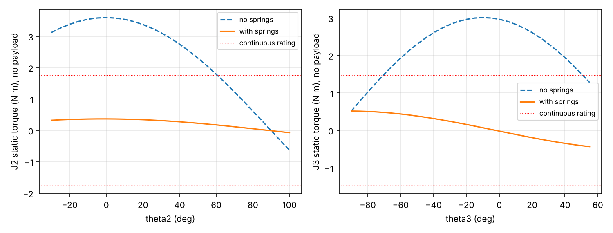
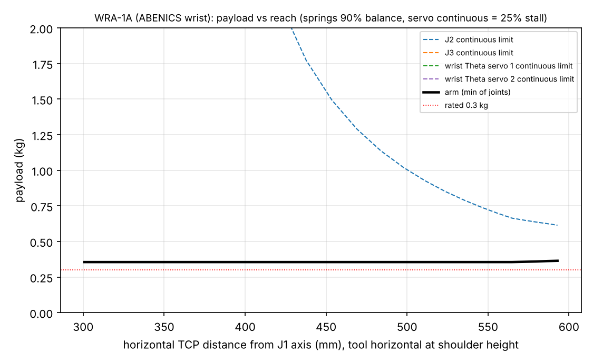
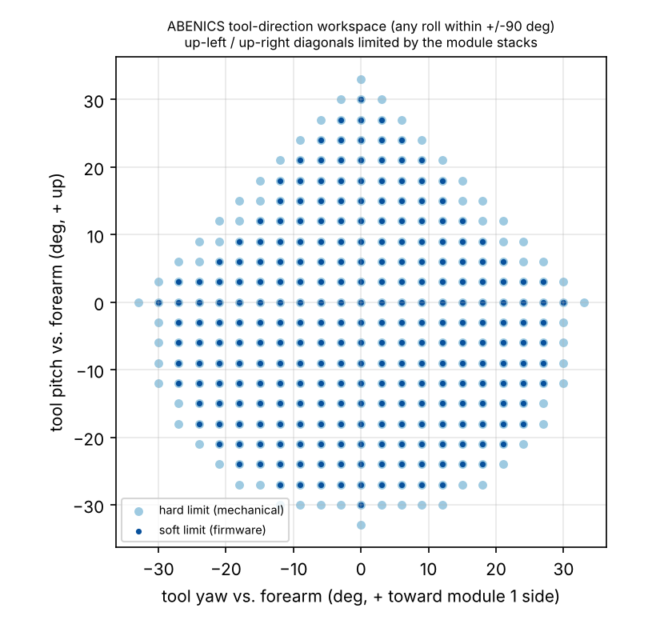
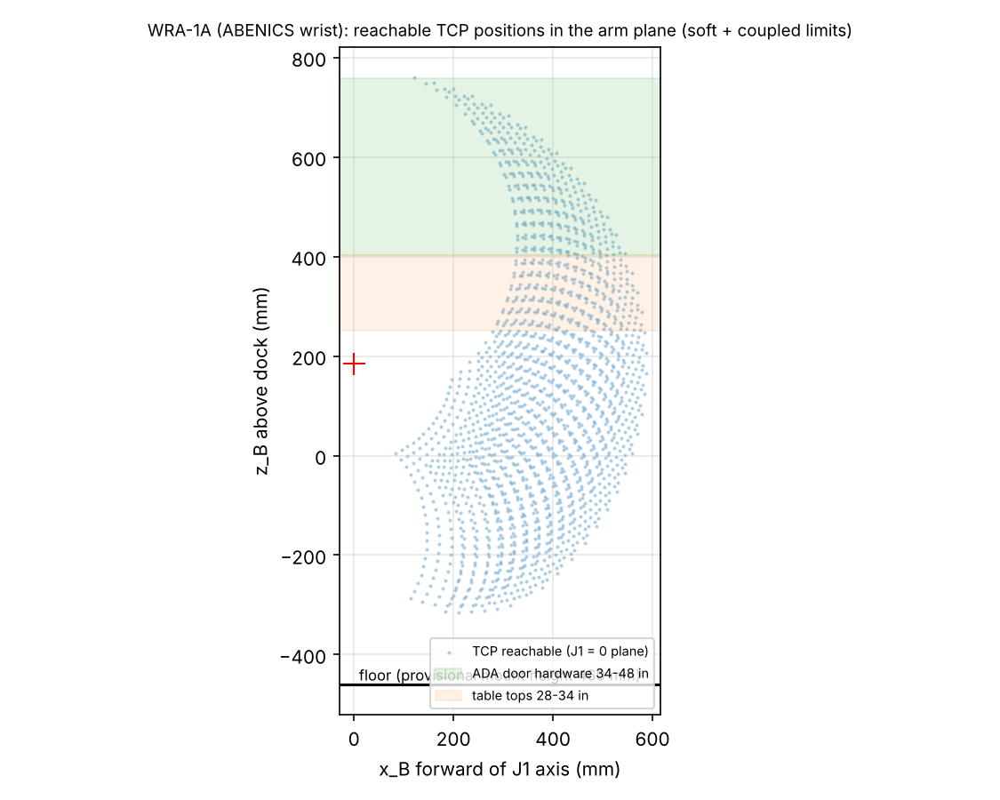
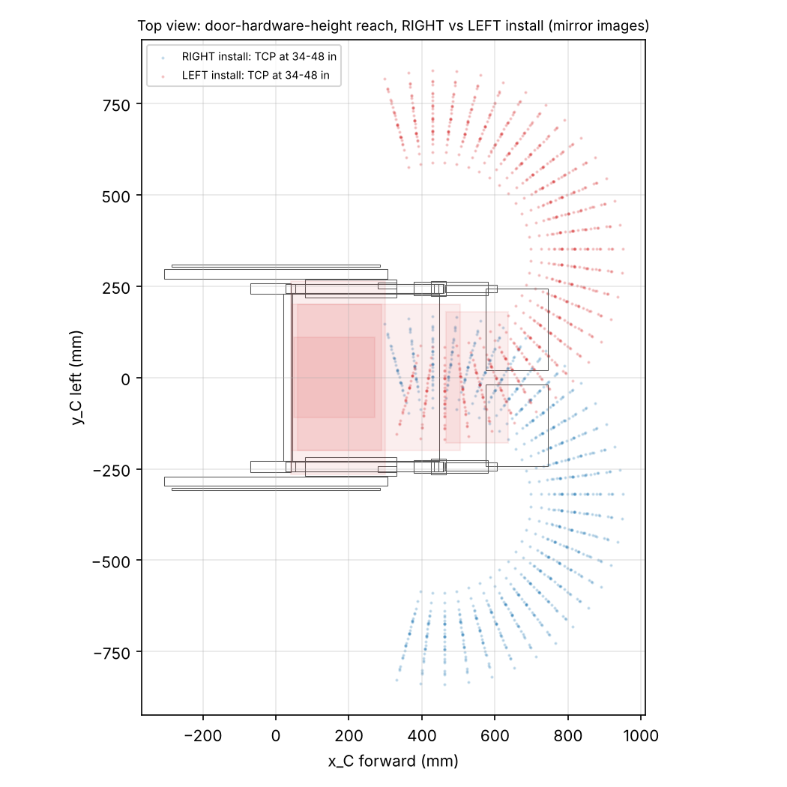
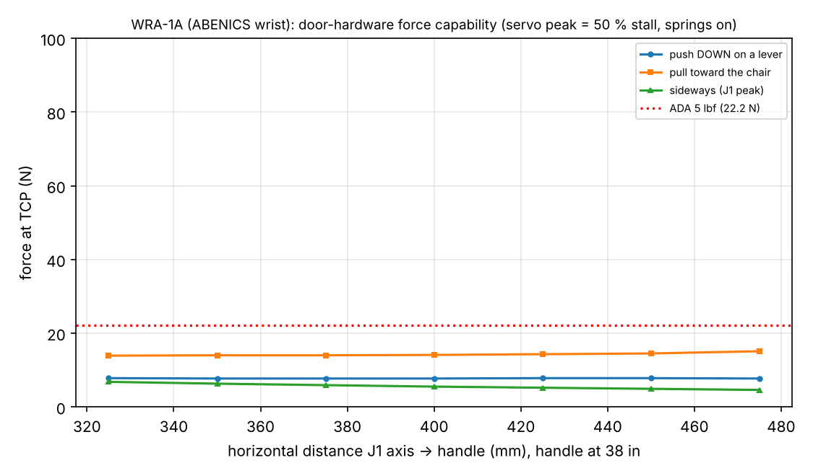
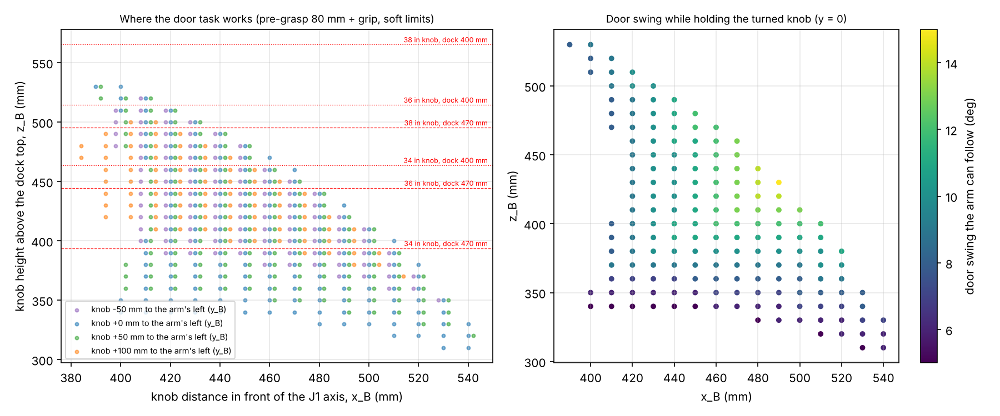

# 05 - Engineering calculations (GENERATED by `python calcs/arm_calcs.py`; do not edit)

Variant: **WRA-1A (ABENICS wrist)**.  Generated 2026-10-12T10:17:25.  Inputs: `cad/wra/params.yaml`, CAD centroids, printed masses from `output/reports/parts.json`.  Tags: [V] verified, [C] computed, [E] estimate, [D] design rule.
Figures: `calcs/output/*.png`.  Raw numbers: `calcs/output/results.json`.

## 1. Mass

| group | mass (g) |
|---|---|
| base_fixed_B | 419 |
| turntable_T_incl_J1J2J3_servos | 997 |
| upper_arm_U | 312 |
| j3_hub_K | 64 |
| parallelogram_rod | 74 |
| forearm_F_incl_ABENICS_housing_modules_4_servos | 909 |
| tool_S_cs_gear | 89 |
| claw_G_incl_servo | 293 |
| arm_total_on_dock | 3157 |
| moving_beyond_J2 | 1741 |

Arm on the dock: **3.16 kg**; moving beyond the shoulder (J2): **1.74 kg** [C].

## 2. Joint capacities (servo derating 25 % continuous / 50 % peak of 2.94 N m stall [V])

| joint | ratio | continuous (N m) | peak (N m) |
|---|---|---|---|
| j1 | 1.5 | 1.103 | 2.205 |
| j2 | 2.3889 | 1.756 | 3.512 |
| j3 | 2.0 | 1.47 | 2.94 |
| j6 | 1.0 | 0.735 | 1.47 |
| w1 | 1.0 | 0.735 | 1.47 |
| w2 | 1.0 | 0.735 | 1.47 |
| q1 | 1.0 | 0.735 | 1.47 |
| q2 | 1.0 | 0.735 | 1.47 |

w1/w2 = Theta servos (quoted at the servo; sphere torque about the module's actuated axis = 1.50 x servo torque), q1/q2 = carrier servos (no static load from the tool: mesh forces act on the module axis)

## 3. Gravity balance springs (zero-free-length emulation)

| joint | gravity coefficient G (N m) | k per spring (N/mm) | max force per spring (N) | spec |
|---|---|---|---|---|
| j2 | 3.589 | 1.122 | 87.5 | extension spring, rate 1.12 N/mm (+/-10%), max working force >= 114 N, working stroke >= 70 mm, initial tension < 10 N; cord length set so tension = k x (distance A-B) |
| j3 | 3.317 | 1.555 | 105.7 | extension spring, rate 1.55 N/mm (+/-10%), max working force >= 137 N, working stroke >= 50 mm, initial tension < 22 N; cord length set so tension = k x (distance A-B) |

Worst static joint torques over the workspace (N m):

| case | j2 | j3 | w1 | w2 |
|---|---|---|---|---|
| no springs, no payload | 3.596 | 2.999 | -0.005 | -0.005 |
| springs, no payload | 0.366 | 0.667 | -0.005 | -0.005 |
| springs + rated payload | 1.102 | 1.311 | -0.005 | -0.005 |

## 4. Payload vs reach

Max horizontal TCP reach **593 mm** from the J1 axis; payload there **0.36 kg** (continuous ratings).  Rated payload 0.3 kg holds out to 593 mm.

## 5. ABENICS wrist

* Limits (soft/hard): tilt (30.0, 33.0) deg, toward a module axis (21.0, 24.0) deg, |Theta| (220.0, 236.0) deg, |q| (120.0, 125.0) deg.
* Sphere torque per module (cont/peak): [1.1, 2.21] N m; roll (both modules): [2.21, 4.41] N m; knob-turn limit 30 % -> 2.65 N m.
* Worst Theta-servo torque holding claw + rated payload, forearm horizontal, any (pitch, yaw, roll): **0.334 N m** at (0, -15, 0) -> margin 2.2 on the continuous rating.
* q-servos: none from the tool (mesh forces act through the module axis); carrier gravity only: < 0.03 N m [C].
* Speeds: {'tilt_or_roll_from_theta': 180.0, 'carrier_q': 270} deg/s.

## 6. Structure, gears and belts (margin = allowable / stress; >= 1 required)

| item | stress (MPa) | allowable (MPa) | margin | note |
|---|---|---|---|---|
| dock plate bending at thumb screw (base housing, PA-CF) | 12.4 | 15.0 | 1.21 | M_dock = 8.46 N m static x 3.0 dynamic; screw force 264 N |
| post bracket spine/gusset root (PA-CF, layers along load) | 12.3 | 15.0 | 1.22 | design moment 35.3 N m (3 g); aluminium option: output/dxf |
| strut clevis bolt bearing (PA-CF) | 10.9 | 18.8 | 1.72 | bearing allowable ~2.5x tensile for confined printed material [E] |
| J2 stub axle 15 mm h6 steel (bending at cheek) | 49.4 | 200.0 | 4.05 | steel yield/2 [E] |
| elbow pin 10 mm h6 (bending) | 13.4 | 200.0 | 14.9 | forearm side + payload x 3.0 |
| upper-arm tube pair (6063-T5) at the hub, 3 g, springs ignored | 18.1 | 72.5 | 4.0 | conservative: full moment |
| forearm tube pair (6063-T5) at the forearm root, 3 g | 18.7 | 72.5 | 3.88 | wrist + tool + payload at the wrist; conservative lever |
| tube socket contact pressure (UA hub, PETG/PA-CF) | 4.3 | 12.5 | 2.93 | plus M3 cross-bolt and structural epoxy - see assembly manual |
| claw pinion 14T m1.5 x 10 mm, Lewis (continuous 25 %) | 8.4 | 30.0 | 3.56 | tangential 35 N per rack mesh; print in PA-CF, 0.12 mm layers |
| claw pinion 14T m1.5 x 10 mm, Lewis (knob mode 50 %, <= 10 s) | 16.8 | 30.0 | 1.78 | tangential 70 N per rack mesh; print in PA-CF, 0.12 mm layers |
| ABENICS monopole 17T m1.5 teeth (eff. face 6 mm), Lewis (continuous 25 %) | 15.9 | 30.0 | 1.89 | F_t = 43 N; sphere torque 1.10 N m per module |
| Theta spur pair 20T/15T m1.5 x 4.5 mm, Lewis 15T (continuous 25 %) | 25.1 | 30.0 | 1.19 | F_t = 49 N |
| ABENICS monopole 17T m1.5 teeth (eff. face 6 mm), Lewis (knob turn 30 %) | 19.0 | 30.0 | 1.58 | F_t = 52 N; sphere torque 1.32 N m per module |
| Theta spur pair 20T/15T m1.5 x 4.5 mm, Lewis 15T (knob turn 30 %) | 30.1 | 30.0 | 1.0 | F_t = 59 N |
| ABENICS monopole 17T m1.5 teeth (eff. face 6 mm), Lewis (peak 50 % (not used)) | 31.7 | 30.0 | 0.95 **< 1** | F_t = 86 N; sphere torque 2.21 N m per module |
| Theta spur pair 20T/15T m1.5 x 4.5 mm, Lewis 15T (peak 50 % (not used)) | 50.2 | 30.0 | 0.6 **< 1** | F_t = 98 N |
| centre-ball post 8 x 1 mm tube, bending at the clamp (stainless 304) | 56.1 | 140.0 | 2.49 | F = 48 N (3 g tool + payload, + mesh separating forces), lever 40 mm; 6063-T5 aluminium would give margin 1.72 |
| centre ball / socket contact pressure (PA-CF on PA-CF, greased) | 0.6 | 8.0 | 14.11 | allowable ~8 MPa for slow sliding of filled nylon [E]; keep greased |
| HTD-3M-15 belt J1 effective tension at peak torque | 5.7 | 11.2 | 1.96 | N per mm of belt width (Gates working tension) [V] |
| HTD-3M-15 belt J2 effective tension at peak torque | 5.7 | 11.2 | 1.96 | N per mm of belt width (Gates working tension) [V] |
| HTD-3M-15 belt J3 effective tension at peak torque | 5.7 | 11.2 | 1.96 | N per mm of belt width (Gates working tension) [V] |

Dock: static moment 8.46 N m (design x3: 25.38 N m); thumb-screw force 264 N vs ~1200 N insert pull-out [E] (margin 4.55).
Torque strut: 1091 N for a 24.0 N m twist about the post.

## 7. Belts

| joint | effective tension at peak (N) | allowable (N) | margin | static pretension (N) |
|---|---|---|---|---|
| j1 | 85.5 | 168 | 1.96 | 53.0 |
| j2 | 85.5 | 168 | 1.96 | 53.0 |
| j3 | 85.5 | 168 | 1.96 | 53.0 |

## 8. Power

8 servos: typical 31.2 W, worst 150.0 W (12.5 A at 12 V); system typical 43.2 W, worst 177.0 W; runtime on a 72.0 Wh pack ~1.4 h typical.  Worst case = all 8 servos at the 50 % torque limit at once (not a normal state); the 25 A fuse and the 20 A converter's own current limit cover it.

## 9. Accuracy budget (TCP, mm)

| source | values |
|---|---|
| j1 | {'encoder_mm': 0.61, 'servo_backlash_mm': 3.45, 'belt_stretch_mm_at_rated_payload': 0.15} |
| j2 | {'encoder_mm': 0.38, 'servo_backlash_mm': 2.17, 'belt_stretch_mm_at_rated_payload': 0.09} |
| j3 | {'encoder_mm': 0.29, 'servo_backlash_mm': 1.63, 'belt_stretch_mm_at_rated_payload': 0.05} |
| wrist | {'theta_path_deg': 1.05, 'q_path_deg': 0.92, 'tcp_mm': 3.53, 'encoder_mm': 0.15} |

RSS of all listed terms: **5.7 mm** [E: servo backlash 0.5 deg and printed-gear backlash 0.15 mm are assumptions - measure in test T2.4].

## 10. Workspace and door tasks

TCP x range [83, 587] mm, z range (above the dock) [-314, 760] mm; reaches the floor: False.

Knob turning (grip slip torque vs wrist roll capacity; knob mode caps the Theta servos at 30 % of stall):

| case | jaw force (N) | slip torque, mu 0.5 / 0.8 (N m) | wrist roll capacity (N m) | knob torque capacity, mu 0.5 / 0.8 (N m) | limited by |
|---|---|---|---|---|---|
| knob_50mm_continuous grip | 35.0 | [1.14, 1.83] | 2.21 | [1.14, 1.83] | grip slip |
| knob_56mm_continuous grip | 35.0 | [1.28, 2.05] | 2.21 | [1.28, 2.05] | grip slip |
| knob_64mm_continuous grip | 35.0 | [1.46, 2.34] | 2.21 | [1.46, 2.21] | grip slip (TPU) / wrist roll (silicone) |
| knob_50mm_knob mode (<= 10 s) | 70.0 | [2.28, 3.66] | 2.65 | [2.28, 2.65] | grip slip (TPU) / wrist roll (silicone) |
| knob_56mm_knob mode (<= 10 s) | 70.0 | [2.56, 4.09] | 2.65 | [2.56, 2.65] | grip slip (TPU) / wrist roll (silicone) |
| knob_64mm_knob mode (<= 10 s) | 70.0 | [2.92, 4.68] | 2.65 | [2.65, 2.65] | wrist roll |

Demand: typical residential latch 0.3-1.5 N m [E]; BHMA A156.2 maximum 3.2 N m.  In knob mode the arm covers the typical range at either friction value; it cannot reach the BHMA maximum.

Knob reach window: `calcs/knob_window.py` -> docs/10_door_tasks.md.

## 11. Claw

{'opening_mm': [0.0, 65.0], 'jaw_force_N_cont_knob': [35.0, 70.0], 'pinion_r_mm': 10.5, 'jaw_speed_mm_s': 49.5, 'close_time_full_s': 0.66, 'servo_deg_full_stroke': 177.3, 'v_groove_deg': 100, 'v_normal_force_factor': 1.305, 'tcp_from_flange_mm': 88.5, 'pad_length_mm': 41.0, 'lip_mm': 6.0, 'note': 'parallel jaws: grip force independent of object size; V pads centre round knobs on the roll axis'}

